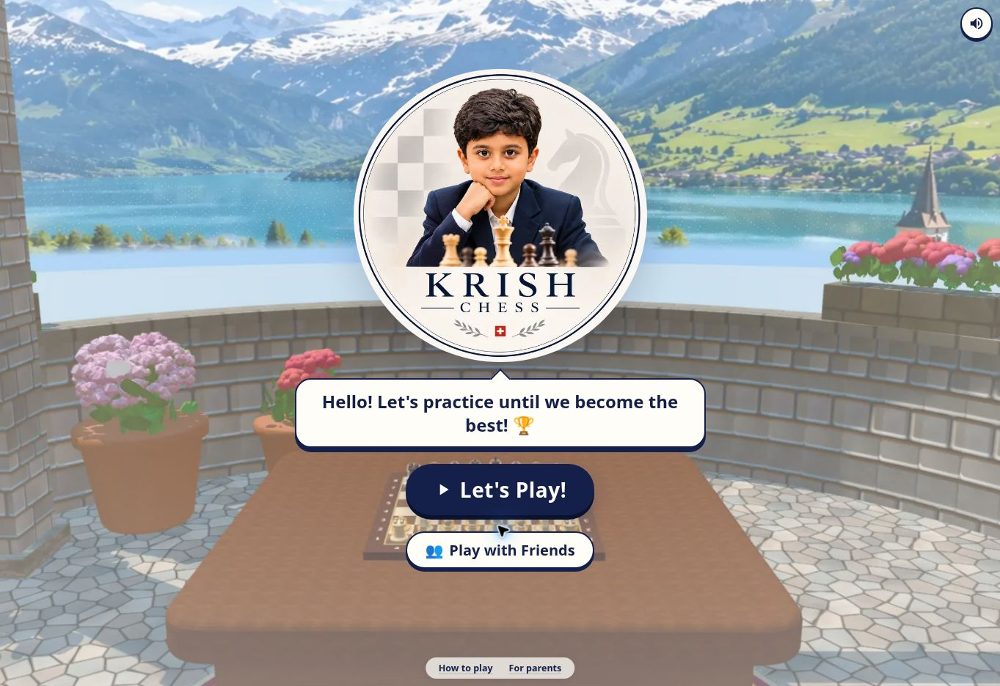

# Krish Chess Online

Start a room and send a friend the link. Two people play. Up to ten can watch and cheer.

[](https://krishchess.com/)

[Play Krish Chess](https://krishchess.com/) and choose **Play with Friends**.

## The server

Each room runs in its own Cloudflare Durable Object. It checks each move and sends the new board to both players over WebSockets.

## Run locally

```sh
npm install
npm run dev
```

Open `/health` on the local server to check it’s running.
